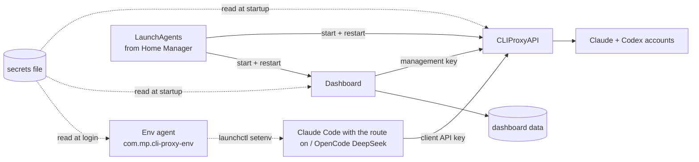

# CLIProxyAPI and the usage dashboard

Nix installs the pinned CLIProxyAPI release and keeps it running with a LaunchAgent. The usage dashboard is a second LaunchAgent pointed at a local checkout of the private repo `github.com/mplibunao/cli-proxy-dashboard`. Packaging that repo was not possible from a machine that cannot read it; this runbook is the setup that is possible. [ADR-026](../../decisions/026-cliproxyapi-prebuilt-launchagent.md) records the packaging choice.

A third LaunchAgent, `com.mp.cli-proxy-env`, publishes Claude Code's route into the GUI session, so Claude Code uses the proxy by default wherever it starts, and it always publishes the client key that OpenCode's DeepSeek provider uses (see [Claude route](#claude-route)). Codex uses its own ChatGPT login unless a run opts in. OAuth logins only store credentials under `~/.cli-proxy-api`.

## How the pieces fit



Solid arrows are traffic or control. Dotted arrows are keys being read from the secrets file or published into the GUI session. [`api.nix`](../../../modules/cli-proxy/api.nix) and [`dashboard.nix`](../../../modules/cli-proxy/dashboard.nix) set the listener addresses and the launch settings.

## Before the first switch

Create the secret file and the dashboard checkout first. Activation checks both before Home Manager writes any file. A missing one stops the switch and leaves no half-applied generation. `checkCliProxyApiRuntime` in [`api.nix`](../../../modules/cli-proxy/api.nix) checks that the proxy binary runs and that the secret file has both keys. `checkCliProxyDashboardRuntime` in [`dashboard.nix`](../../../modules/cli-proxy/dashboard.nix) checks the dashboard clone and the management key. Read them for the complete list. The same modules set the listener defaults, including the dashboard port, which must differ from the surf OpenAI gateway's.

### Secret file

The management key and the client key are not in git and not in the Nix store. There is no sops or agenix setup in this repo. `init-secret` creates `~/.config/cli-proxy-api/secrets.env` mode `0600` with a random `CLIPROXY_MANAGEMENT_KEY` only. It doesn't print the value, and it refuses to overwrite an existing file. OAuth logins stay manual.

```fish
~/Projects/personal/dotfiles/scripts/cli-proxy-dashboard-setup init-secret
```

`init-client-key` then adds `CLIPROXY_CLIENT_KEY`. It appends one line and leaves the management key in place. It refuses when the client line is already there, and it does not print the value. Run both commands before the first switch, because the proxy check needs both keys. To rotate, delete the `CLIPROXY_CLIENT_KEY` line without printing the file, then follow [Apply a new client key](#apply-a-new-client-key).

```fish
~/Projects/personal/dotfiles/scripts/cli-proxy-dashboard-setup init-client-key
```

v8.0.53 accepts client keys only as `access.api-keys` (the old top-level `api-keys` list is that same field; `MANAGEMENT_PASSWORD` is only the management key), so the launch wrapper copies the store config to a mode-0600 runtime file and appends the client key there. The store symlink `~/.config/cli-proxy-api/config.yaml` stays free of keys. The runtime file is `~/.local/state/cli-proxy-api/runtime-config.yaml`, rebuilt on every start, so a management-API edit of it does not survive a restart. OAuth credentials live only under `~/.cli-proxy-api`.

### Dashboard checkout

The live dashboard runs from its own clone, `~/.local/share/cli-proxy-dashboard/app`, which only follows `main`. Work on the dashboard happens in a different checkout, such as `~/Projects/personal/cli-proxy-dashboard`, so switching branches there never changes what the live dashboard runs. The live copy is a separate git clone, which worktree cleanup leaves alone.

[`scripts/cli-proxy-dashboard-setup`](../../../scripts/cli-proxy-dashboard-setup) deploys `main` to that clone. Its header and `--help` describe the clone, build, and checks it makes. If the dashboard LaunchAgent is already loaded, it restarts that job. The path below works before the `~/.local/bin` shim exists. After a switch, `cli-proxy-dashboard-setup` is on `PATH`.

Open a fish shell once so Corepack installs `pnpm` beside mise Node 24 if it is not there yet, then:

```fish
~/Projects/personal/dotfiles/scripts/cli-proxy-dashboard-setup
```

Nix does not pin a dashboard commit. Rerun the command to deploy a newer `main`. There is no flake input to bump.

[`dashboard.nix`](../../../modules/cli-proxy/dashboard.nix) sets the default checkout, the Bun command, and the environment the job runs with.

Feature switches live in the dashboard repo's `config/production.env`, not in Nix. The soonest-reset routing controller is on there (`SOONEST_RESET_ROUTING=1`, `SOONEST_RESET_DRY_RUN=0`). To change a switch, edit that file in the dashboard repo, merge to `main`, and run `cli-proxy-dashboard-setup`. You don't need a Nix switch for it. The plist sets none of them, because a variable already in the process environment would override the file.

Moving the live dashboard from `~/Projects/personal/cli-proxy-dashboard` to the clone takes one deploy and one switch. Run `cli-proxy-dashboard-setup` first, so the clone has `config/production.env` and `node_modules`. Its restart still hits the old checkout, which is harmless. Then switch. The plist changed, and the switch reloads the job from the clone. Check that one `bun` process remains, running in the clone:

```fish
pgrep -fl 'src/server/index.ts'
lsof -a -p (pgrep -f 'src/server/index.ts') -d cwd -Fn | grep '^n'
```

## Switch

Switch with the [level 4 command of the command ladder](../command-ladder.md#level-4-apply), after the checks before it pass and you have approval.

A switch reloads a job whose LaunchAgent plist changed: it runs `launchctl bootout`, waits for launchd to drop the job, then `launchctl bootstrap`, and fails if the job does not stay up for a few seconds. launchd reads a plist only when the job is bootstrapped, so `launchctl kickstart -k` restarts the old definition and a changed plist never takes effect without that reload. An unchanged job is left running. The plist that was loaded is recorded in `~/.local/state/cli-proxy-api/com.mp.cli-proxy-api.loaded-plist` (and the same under `cli-proxy-dashboard`); the first switch after this logic was added reloads each job once because no record exists yet.

To reload by hand:

```fish
launchctl bootout gui/(id -u)/com.mp.cli-proxy-api
launchctl bootstrap gui/(id -u) ~/Library/LaunchAgents/com.mp.cli-proxy-api.plist
launchctl bootout gui/(id -u)/com.mp.cli-proxy-dashboard
launchctl bootstrap gui/(id -u) ~/Library/LaunchAgents/com.mp.cli-proxy-dashboard.plist
```

## Logins

Run these from a GUI session after the proxy is up. Each one opens a browser. Add `--no-browser` to print the URL instead. Tokens are written under `~/.cli-proxy-api`, which Nix does not replace.

```fish
cli-proxy-api --config ~/.config/cli-proxy-api/config.yaml --claude-login
cli-proxy-api --config ~/.config/cli-proxy-api/config.yaml --codex-login
```

`~/.config/cli-proxy-api/config.yaml` is a symlink into the store and has no client key. Login commands above use that file. The LaunchAgent starts with `~/.local/state/cli-proxy-api/runtime-config.yaml` instead. Startup does not rewrite the store symlink. The runtime file is rebuilt from the store template plus `CLIPROXY_CLIENT_KEY` on every start, so change the module and switch instead of editing either file.

## Check that both jobs are running

```fish
launchctl print gui/(id -u)/com.mp.cli-proxy-api | grep -E '^[[:space:]](state|pid|runs|last exit code) = '
launchctl print gui/(id -u)/com.mp.cli-proxy-dashboard | grep -E '^[[:space:]](state|pid|runs|last exit code) = '
```

A running job has a `pid` line. The filter keeps only those fields, because the full output includes the job's inherited environment, which holds the published client key. Logs, mode `0600` because the job umask is `077`:

```fish
ls -l ~/.local/state/cli-proxy-api ~/.local/state/cli-proxy-dashboard
```

Open the dashboard:

```fish
open http://127.0.0.1:8788
```

Usage data is in `~/.local/share/cli-proxy-dashboard`. Use the port you actually configured if it is not 8788.

## Claude route

Claude Code uses the proxy by default wherever it starts: RepoPrompt CE, T3 Code, terminals and `ccy`. It works without wrapping any app, because the route comes from the environment that launchd gives GUI apps, which terminals inherit too. Claude Desktop's Claude Code sessions go direct whatever the route. Desktop starts them with `ANTHROPIC_BASE_URL` set to `https://api.anthropic.com` (seen with its bundled Claude Code 2.1.317). The proxy never sees those requests. Codex goes direct by default (see [Codex](#codex)).

### Variables the env agent publishes

`com.mp.cli-proxy-env` is a one-shot LaunchAgent. It runs at login, at a switch that changes its plist, and whenever `claude-proxy-route` re-runs it. It reads `CLIPROXY_CLIENT_KEY` from the secrets file (mode `0600`, same checks as the management key, nothing echoed) and reads the route setting, then runs `launchctl setenv` or `unsetenv`:

| Variable | Route on | Route off |
| --- | --- | --- |
| `ANTHROPIC_BASE_URL` | `http://127.0.0.1:8317` | Unset |
| `ANTHROPIC_AUTH_TOKEN` | The client key | Unset |
| `CLIPROXY_CLIENT_KEY` | The client key | The client key, still published for OpenCode's DeepSeek route |

It doesn't touch `CLI_PROXY`, `OPENAI_BASE_URL`, Codex settings, `ANTHROPIC_API_KEY` or `CLAUDE_CODE_OAUTH_TOKEN`. The key is briefly in `launchctl setenv` arguments, and `launchctl print` of the agent shows it in the inherited environment, so don't share that output. The agent writes its messages to `~/.local/state/cli-proxy-api/cli-proxy-env.err.log`, and they never contain a key. Its code is `scripts/cli-proxy-env-launch`.

If the route setting is malformed, the agent publishes nothing and exits 1. With the route on and no readable key, it also publishes nothing. With the route off and no readable key, it still unsets both Anthropic variables, leaves any key that launchd already holds, and exits 1.

### Route setting

The route setting is the file `~/.local/state/cli-proxy-api/claude-route`.

| Contents | Route |
| --- | --- |
| No file | On |
| `on`, with an optional final newline | On |
| `off`, with an optional final newline | Off |
| Anything else, including an empty or unreadable file or a parent directory that can't be searched | Error, never read as on or off |

`claude-proxy-route on` and `off` are its only writers. They write a mode-0600 file and rename it into place. Home Manager doesn't manage it, so a switch or a rollback never resets it, and it survives logout and reboot. The path is fixed under `$HOME` and ignores `XDG_STATE_HOME`, because `claude-launch` reads the same literal path. `claude-launch` and `claude-proxy-route` also assume the proxy URL `http://127.0.0.1:8317`, so the module asserts that `xdg.stateHome` is `~/.local/state` and that the proxy listens on `127.0.0.1:8317`.

### Turn the route off or on

```fish
claude-proxy-route off      # Claude Code goes direct
claude-proxy-route on       # Claude Code goes through the proxy
claude-proxy-route apply    # publish again without changing the setting
claude-proxy-route status   # show the setting and what launchd publishes
```

`on`, `off` and `apply` re-run the env agent with `launchctl kickstart`, wait up to 15 seconds for the run to finish, and then print `status`. Running a command again is also the retry. Use `apply` after rotating the client key or after fixing a failed publication. Run the command as yourself in the logged-in GUI session, not with `sudo` and not over SSH.

`status` never prints a value:

```text
saved setting:        on
published route:      on
published client key: present
```

`saved setting` notes when `on` comes from a missing file, and shows the error for a malformed one. `published route` is `on` (both Anthropic variables set and the URL is the proxy's), `off` (both unset), `mixed` (a partial publication) or `unavailable` (`launchctl` couldn't be queried). `published client key` is `present`, `missing` or `unavailable`. `status` exits 1 when the setting is malformed, or when launchd doesn't match the setting, can't be queried, or lacks the key. Run `apply` once the cause is fixed.

When the agent fails, `on`, `off` and `apply` exit 1 and show the last lines of the agent's error log. `on` and `off` also say that the setting was saved. When the agent isn't loaded, for example after a manual `bootout`, they print the `launchctl bootstrap` command that loads it, which also runs it once.

The command doesn't change running processes. Restart apps afterward (see [Restart after a change](#restart-after-a-change)).

### Per-launch overrides

`claude-launch` and `codex-launch` are claude-toolkit scripts. Home Manager links them into `~/.local/bin` from `~/Projects/personal/ai/claude-toolkit/scripts/`. With `CLI_PROXY` unset, `claude-launch` reads the route setting on every launch. `CLI_PROXY=0` sends one launch direct and `CLI_PROXY=1` sends it through the proxy, without reading the setting. `codex-launch` goes direct unless `CLI_PROXY=1`. claude-toolkit's `mcp-configs/secrets-wrapper.md` (section "CLIProxyAPI routing") covers the accepted values, the environment each launcher passes to the agent, and the launcher errors.

- `ccy` is `claude-launch --dangerously-skip-permissions`. It doesn't go through `clm`, so it has no `context/repo-prompt-ce` and no `--strict-mcp-config`, and Claude loads its ordinary MCP configuration. `ccnt` still uses `clm`.
- `clm` and plain `claude` use the environment they inherit, so `CLI_PROXY=0 clm` has no effect. For a direct session with explicit MCP selection, run `CLI_PROXY=0 claude-launch --mcp-config <file> --strict-mcp-config`.
- T3 Code runs `claude-launch` and `codex-launch` as its provider binaries. With these dotfiles, its Claude provider doesn't need a `CLI_PROXY` entry.
- The `~/.local/bin` links point into the working checkouts of claude-toolkit and this repo, so switching branches there changes `claude-launch`, `codex-launch` and `claude-proxy-route` immediately. The env agent runs from the Nix store and changes only at a switch.

### Claude authentication and lost features

While the route is on, `ANTHROPIC_AUTH_TOKEN` takes precedence over Claude Code's saved claude.ai login. Claude Code keeps the saved login but doesn't use it, and the proxy picks the upstream account from `~/.cli-proxy-api`. A direct launch goes back to the saved login unless a higher-priority credential is set: `ANTHROPIC_API_KEY`, `CLAUDE_CODE_OAUTH_TOKEN`, `apiKeyHelper` or cloud-provider settings. `/status` inside Claude shows which credential and base URL it uses.

Proxied sessions lose claude.ai connectors, Remote Control and voice dictation. MCP tool search is off by default, and features that depend on subscription flags may be missing. claude-toolkit's `settings.json` turns on `remoteControlAtStartup` and `voiceEnabled`, and both do nothing in a proxied session. These losses are accepted. Use `CLI_PROXY=0 claude-launch` for a session that needs any of them.

### Restart after a change

A running process keeps the environment it started with. After `claude-proxy-route on` or `off`, or after a switch that changes what the env agent publishes:

- Quit and reopen RepoPrompt CE, including a separately running Debug build. It caches its shell environment until the whole app quits, and a RepoPrompt opened from an old terminal brings the old values back.
- Quit the terminal app and open it again. A new tab, or a new fish in a running terminal, inherits that terminal's old environment.
- T3 Code's Claude follows the setting at its next session, because `claude-launch` reads the file itself and removes inherited route variables in direct mode. Turning the route back on needs `CLIPROXY_CLIENT_KEY` in T3's environment, so restart T3 if it started before the key was published.

Open apps from a fresh parent: the Dock, Spotlight or a newly opened terminal app. When unsure what an app inherited, log out and back in, then run `claude-proxy-route status`.

An app that macOS reopens at login can start before the env agent runs. For RepoPrompt CE, its Debug build (process `RepoPromptDebug`) and kitty, the agent reports this itself. After every publication, it compares the starting environment of each copy you run with the three values it just published. A macOS notification titled "Claude proxy route is on" (or "off") then names the apps to quit and reopen, such as "Relaunch: RepoPrompt, kitty". When nothing differs, no notification appears. If `osascript` reports an error, the agent's error log names the apps instead. Notification settings or Focus can hide the banner without an error, so check Notification Center when an app behaves as if it missed the route. The watched process names are `watchedProcesses` in `modules/cli-proxy/api.nix`. T3 Code isn't watched, because `claude-launch` reads the route setting at every session and stops with an error when it can't follow it.

### If the env agent failed at login

If the secrets file is missing or not mode `0600`, or the route setting is malformed, the agent publishes nothing at login. RepoPrompt, `clm` and plain `claude` then start Claude Code without the proxy variables and use the saved login, with no error. The agent checks apps only after a successful publication, so no relaunch notification appears either. Only `claude-launch` stops: T3 Code and `ccy` report the malformed setting or, with the route on, that the proxy route needs `CLIPROXY_CLIENT_KEY`. `claude-proxy-route status` exits 1, for example with setting `on` and route `off`, and the agent's error log names the cause. Fix the cause, run `claude-proxy-route apply`, and restart the apps.

### If the proxy is down

While the route is on, a proxy outage stops every new proxied Claude request. Claude never falls back to direct, and `claude-proxy-route` doesn't start, stop or health-check the proxy. The env agent and the proxy start independently, so the route can be published before port 8317 accepts connections. To use Claude without the proxy, run `claude-proxy-route off` and restart RepoPrompt CE and terminals. T3 Code and `ccy` follow the setting at their next launch. When the proxy is back (the restart commands are under [Switch](#switch)), run `claude-proxy-route on` and restart the same apps.

### Which app sent a request

The proxy's access log, `~/.local/state/cli-proxy-api/cli-proxy-api.out.log`, shows every client as `127.0.0.1`. Claude Code requests are `POST "/v1/messages?beta=true"`, Codex requests are `POST "/v1/responses"`, and OpenCode DeepSeek requests are `POST "/v1/chat/completions"`. The dashboard's usage records don't identify the client either. To tie a request to an app, watch the log and check the app's `claude` process while the request runs:

```fish
tail -n0 -F ~/.local/state/cli-proxy-api/cli-proxy-api.out.log | grep --line-buffered -E 'POST +"/v1/(messages|responses|chat/completions)'
ps -axo pid,ppid,comm       # follow ppid from the app to its claude child
lsof -nP -a -p <pid> -iTCP:8317
ps -E -o command= -p <pid> | tr ' ' '\n' | grep -E '^ANTHROPIC_BASE_URL='
```

`lsof` shows a connection to port 8317 while a proxied request runs. The last command prints only the base URL. Never print `ps -E`, `env`, `launchctl print` or `launchctl getenv ANTHROPIC_AUTH_TOKEN` output unfiltered, because each can show the client key.

### Apply a new client key

Activation checks that the secrets file is mode `0600` and that `CLIPROXY_CLIENT_KEY` is present, not empty and not the placeholder. It doesn't check the format. The proxy checks for 64 hex characters when it starts, and exits on a malformed key. The proxy and the env agent read the key when they run, so a new or rotated key doesn't need a switch:

```fish
~/Projects/personal/dotfiles/scripts/cli-proxy-dashboard-setup init-client-key
launchctl bootout gui/(id -u)/com.mp.cli-proxy-api
launchctl bootstrap gui/(id -u) ~/Library/LaunchAgents/com.mp.cli-proxy-api.plist
claude-proxy-route apply
```

Then restart apps as under [Restart after a change](#restart-after-a-change). An app that started with the old key fails against the restarted proxy.

### Codex

Codex goes direct by default. claude-toolkit's synced Codex config has no `cliproxy` provider, so Codex Desktop, RepoPrompt's Codex agent and plain `codex` use the ChatGPT login. The Claude route setting doesn't affect them. `cdx` runs `codex-launch`, which goes direct unless `CLI_PROXY=1` adds per-run provider overrides for the proxy. That route uses the Responses API over HTTP and doesn't support Codex's WebSocket transport. Run `codex login` only if `codex login status` doesn't show ChatGPT.

Keep the Codex login in `~/.cli-proxy-api`. The proxy holds it so the dashboard can read Codex limits.

## DeepSeek for OpenCode

OpenCode's DeepSeek requests go through the proxy so they appear in its usage records and the dashboard. OpenCode sends `CLIPROXY_CLIENT_KEY` (from the env agent) to `http://127.0.0.1:8317/v1`. The proxy holds the real DeepSeek key. Models `deepseek-v4-pro` and `deepseek-flash` keep their names. RepoPrompt and T3 Code launch `opencode acp` and read the same OpenCode config. See [OpenCode in RepoPrompt CE](opencode-repoprompt.md#opencode-deepseek-proxy).

Add the key once. `DEEPSEEK_API_KEY` is optional in `secrets.env`. Without it the proxy starts with no DeepSeek entry. The commands below keep the key off the screen and out of shell history, and `>>` keeps the file mode:

```fish
read -s -P 'DeepSeek API key: ' ds_key
printf 'DEEPSEEK_API_KEY=%s\n' $ds_key >>~/.config/cli-proxy-api/secrets.env
set -e ds_key
chmod 0600 ~/.config/cli-proxy-api/secrets.env
grep -c '^DEEPSEEK_API_KEY=' ~/.config/cli-proxy-api/secrets.env
```

The last command prints `1` and no value. To rotate, delete the line with `sed -i '' '/^DEEPSEEK_API_KEY=/d' ~/.config/cli-proxy-api/secrets.env`, add it again, and restart the proxy.

Restart the proxy LaunchAgent, which rebuilds `runtime-config.yaml` with the DeepSeek entry (the runtime file is the only place the key is written):

```fish
launchctl bootout gui/(id -u)/com.mp.cli-proxy-api
launchctl bootstrap gui/(id -u) ~/Library/LaunchAgents/com.mp.cli-proxy-api.plist
```

Then follow the OpenCode steps in the other runbook (switch for the new `opencode.jsonc`, logging OpenCode out of DeepSeek, restarting RepoPrompt and T3 Code). To roll back, remove `baseURL` and `apiKey` from the `deepseek` provider options in `opencode.jsonc`, switch, and delete the `DEEPSEEK_API_KEY` line.

## Session affinity

The generated config has a `routing` block that turns on CLIProxyAPI's built-in session affinity:

```yaml
routing:
  session-affinity: true
  session-affinity-ttl: 1h
  session-affinity-rebind-on: quota
```

Follow-up requests in one Claude Code or Codex session stay on the OAuth account the session first used, so the upstream prompt cache is reused. Bindings are kept for 1 hour. With `rebind-on: quota`, a transient failure (408, 5xx, empty stream) fails over for that one request and keeps the session bound to its original account. Quota and auth errors (429, 401/402/403, 404, `invalid_grant`) still move the session to another account. These key names and values come from v8.0.53's `config.example.yaml` and `RoutingConfig` in `internal/config/config_types.go`.

`routing.strategy` is not set, so unbound requests use the upstream default, `round-robin`. A config change alters `CLIPROXY_CONFIG_ID` in the plist, so the switch reloads the proxy job (see Switch).

## Claude Code fingerprint

The generated config also sets the Claude Code fingerprint the proxy sends upstream, in `upstream.claude.header-defaults`: a user-agent with the Claude Code version, plus the package and runtime versions. Anthropic checks that version against each model's minimum. v8.0.53's built-in fingerprint is Claude Code 2.1.280, so without the override every proxied request reports 2.1.280, and a newer model fails with `API Error: 400 Claude Code 2.1.280 does not support this model`, even when the installed Claude Code is newer. The proxy passes a client's own fingerprint through only when all three values equal the configured ones, and sends the configured values for every other client.

When a model needs a newer Claude Code than the configured version, update Claude Code, measure what it sends, and copy the three values into `configText` in `modules/cli-proxy/api.nix`. To measure, run a local listener that prints the request headers, and point a direct Claude Code at it with a placeholder key:

```bash
python3 -I -c '
import http.server
class H(http.server.BaseHTTPRequestHandler):
    def do_POST(self):
        print([self.headers.get(k) for k in ("User-Agent", "X-Stainless-Package-Version", "X-Stainless-Runtime-Version")], flush=True)
        self.send_response(400); self.end_headers()
    do_HEAD = do_POST
http.server.HTTPServer(("127.0.0.1", 18399), H).serve_forever()' &
sleep 1
env -i HOME="$HOME" PATH="$HOME/.local/bin:/usr/bin:/bin" \
    ANTHROPIC_BASE_URL=http://127.0.0.1:18399 ANTHROPIC_API_KEY=placeholder \
    claude -p ok </dev/null
kill %1
```

The line that starts with `['claude-cli/` has the three values. `claude -p` sends `sdk-cli` in the user-agent. Write `cli` in its place, as in `claude-cli/2.1.321 (external, cli)`. Then switch. The config change reloads the proxy job (see [Switch](#switch)).

## Upgrade CLIProxyAPI

Change `version` and the two archive hashes in `packages/cli-proxy-api/default.nix`. The hashes are the upstream `checksums.txt` entries for `darwin_aarch64` and `linux_amd64`, in SRI form. Build `packages.aarch64-darwin.cli-proxy-api` on the Mac, switch, and restart the LaunchAgent. OAuth files in `~/.cli-proxy-api` stay where they are.
